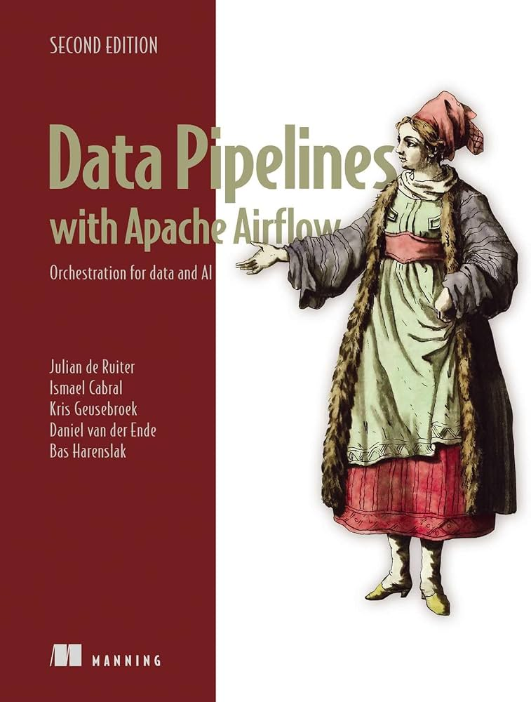

# SmallDataAnalyticsPlatform4

このリポジトリは、[Data Pipelines with Apache Airflow(2nd Edition)](https://www.manning.com/books/data-pipelines-with-apache-airflow-second-edition)の書籍、[動画講座](https://learning.oreilly.com/videos/data-pipelines-with/9781633436374VE/)、および、この書籍の内容を実行するために用意されている[data-pipelines-with-airflow-2nd-ed
](https://github.com/godatadriven/data-pipelines-with-airflow-2nd-ed/tree/master?tab=readme-ov-file)のコードをもとにしています。一部、学習用ノートを追加したり、他のSmallDataAnalyticsPlatformリポジトリと識別可能にするためにcomposeファイルに識別子sdap4cNを付与しています。

# Data Pipelines with Apache Airflow(2nd Edition)
Julian de Ruiter, Ismael Cabral, Kris Geusebroek, Daniel van der Ende, Bas Harenslak
January 2026  ISBN 9781633436374  512 pages

